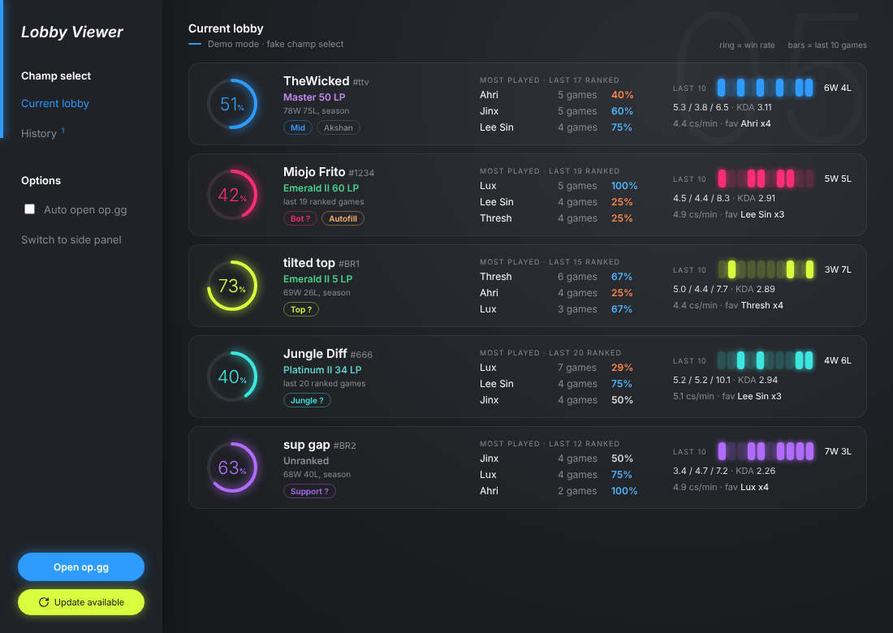

# Lobby Viewer

Simple champ select reveal for League of Legends (Windows).

Shows every teammate's Riot ID in champ select, with their role (guessed from their
recent games when Riot hides it), rank, win rate, most played champions (games and
win rate) and stats from their last 10 games. Keeps your last 5 champ selects in
History. Full layout or a narrow side panel to sit next to the League client.

Everything comes from your own League Client on this PC. No servers, no analytics.

## Setup

1. Install Python from python.org (tick "Add Python to PATH").
2. Double-click `Lobby Viewer.bat` once to install the libraries.
3. After that, just double-click `lobby_viewer.pyw`.
4. To get a new version, click **Update** in the app (it restarts by itself).

Preview without League: `python lobby_viewer.pyw --demo`
